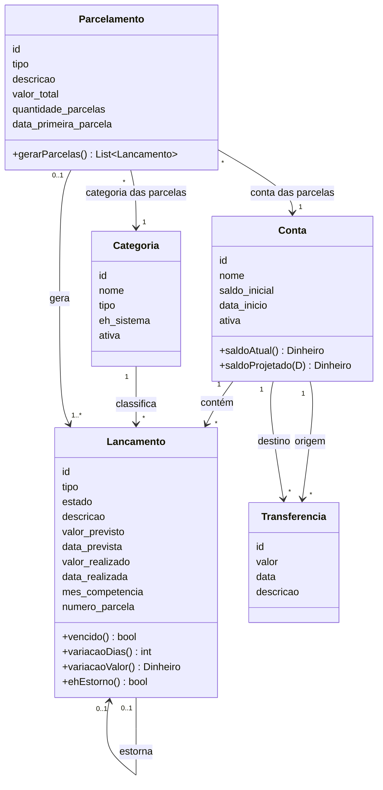

# 05 — Modelo de domínio

- **Status:** Rascunho
- **Versão:** 0.1
- **Última atualização:** 10-10-2026

Modelo conceitual do domínio: entidades, atributos, relacionamentos e fronteiras
de consistência. As regras que governam o comportamento estão em
`03-regras-de-negocio.md` e o significado de cada termo, em `00-glossario.md`.

Aqui só aparece a estrutura do negócio.

## Diagrama de classes (conceitual)

Todas as entidades de negócio pertencem a um **Usuário** (o usuário padrão no
MVP). Ele foi omitido do diagrama para não poluí-lo com cinco setas.

## Entidades

### Conta

Fonte financeira real do usuário.

| Atributo        | Tipo     | Obrigatório | Descrição                                |
| --------------- | -------- | ----------- | ---------------------------------------- |
| `id`            | Id       | Sim         | Identificador                            |
| `nome`          | Texto    | Sim         | Nome da conta                            |
| `saldo_inicial` | Dinheiro | Sim         | Saldo no início do rastreamento          |
| `data_inicio`   | Data     | Sim         | Dia a partir do qual a conta é rastreada |
| `ativa`         | Booleano | Sim         | Falso quando inativada                   |

Derivados (não armazenados): **saldo atual**, **saldo projetado** em uma data de
consulta D.

### Categoria

Classificação de lançamentos. Não há hierarquia: toda categoria está no mesmo
nível.

| Atributo     | Tipo               | Obrigatório | Descrição                                     |
| ------------ | ------------------ | ----------- | --------------------------------------------- |
| `id`         | Id                 | Sim         | Identificador                                 |
| `nome`       | Texto              | Sim         | Nome da categoria                             |
| `tipo`       | Receita ou Despesa | Sim         | Tipo da categoria                             |
| `eh_sistema` | Booleano           | Sim         | Verdadeiro para categorias nativas ("Outros") |
| `ativa`      | Booleano           | Sim         | Falso quando inativada                        |

### Lançamento

Unidade central do sistema: uma receita ou despesa, prevista ou realizada.

| Atributo          | Tipo                             | Obrigatório            | Descrição                           |
| ----------------- | -------------------------------- | ---------------------- | ----------------------------------- |
| `id`              | Id                               | Sim                    | Identificador                       |
| `tipo`            | Receita ou Despesa               | Sim                    | Natureza do lançamento              |
| `estado`          | Previsto, Realizado ou Cancelado | Sim                    | Ciclo de vida                       |
| `descricao`       | Texto                            | Sim                    | Descrição                           |
| `valor_previsto`  | Dinheiro                         | Sim                    | Valor planejado                     |
| `data_prevista`   | Data                             | Sim                    | Data planejada (vencimento)         |
| `valor_realizado` | Dinheiro                         | Somente se Realizado   | Valor efetivamente pago ou recebido |
| `data_realizada`  | Data                             | Somente se Realizado   | Data em que ocorreu                 |
| `mes_competencia` | Mês de competência               | Sim                    | Mês a que o lançamento pertence     |
| `numero_parcela`  | Inteiro                          | Somente se for parcela | Posição da parcela no parcelamento  |

Relacionamentos: pertence a exatamente uma **Conta**; pertence obrigatoriamente
a uma **Categoria**; pode pertencer a um **Parcelamento**; pode estornar outro
Lançamento.

Derivados (não armazenados): **vencido**, **variação de data**, **variação de
valor** (absoluta e percentual) e **é estorno**.

### Parcelamento

Divisão de uma operação em N parcelas mensais. É a origem das parcelas, que
depois vivem como lançamentos independentes.

| Atributo                | Tipo               | Obrigatório | Descrição                        |
| ----------------------- | ------------------ | ----------- | -------------------------------- |
| `id`                    | Id                 | Sim         | Identificador                    |
| `tipo`                  | Receita ou Despesa | Sim         | Natureza das parcelas            |
| `descricao`             | Texto              | Sim         | Descrição                        |
| `valor_total`           | Dinheiro           | Sim         | Valor total da operação          |
| `quantidade_parcelas`   | Inteiro            | Sim         | N                                |
| `data_primeira_parcela` | Data               | Sim         | Data informada para a 1ª parcela |

Relacionamentos: **Conta** e **Categoria** informadas na criação, usadas para
gerar as parcelas.

### Transferência

Movimentação de dinheiro entre duas contas do usuário.

| Atributo    | Tipo     | Obrigatório | Descrição            |
| ----------- | -------- | ----------- | -------------------- |
| `id`        | Id       | Sim         | Identificador        |
| `valor`     | Dinheiro | Sim         | Valor transferido    |
| `data`      | Data     | Sim         | Dia da transferência |
| `descricao` | Texto    | Não         | Observação           |

Relacionamentos: uma **Conta** de origem e uma **Conta** de destino.

### Usuário

Dono dos dados. No MVP existe apenas o usuário padrão.

| Atributo | Tipo  | Obrigatório | Descrição     |
| -------- | ----- | ----------- | ------------- |
| `id`     | Id    | Sim         | Identificador |
| `nome`   | Texto | Sim         | Nome          |

## Tipos de valor

| Tipo               | Descrição                                                 |
| ------------------ | --------------------------------------------------------- |
| Dinheiro           | Valor em reais, representado por inteiro em centavos      |
| Data               | Dia civil, sem horário e sem fuso                         |
| Mês de competência | Mês e ano, representado pelo primeiro dia do mês          |
| Receita ou Despesa | Enumeração com os valores Receita e Despesa               |
| Estado             | Enumeração com os valores Previsto, Realizado e Cancelado |

## Relacionamentos

| De           | Para          | Cardinalidade       | Significado                                  |
| ------------ | ------------- | ------------------- | -------------------------------------------- |
| Conta        | Lançamento    | 1 para muitos       | Todo lançamento pertence a uma conta         |
| Categoria    | Lançamento    | 1 para muitos       | Lançamento pertence a uma categoria          |
| Parcelamento | Lançamento    | 0..1 para 1 ou mais | Parcelamento gera as parcelas                |
| Lançamento   | Lançamento    | 0..1 para 0..1      | Um estorno aponta para o lançamento original |
| Conta        | Transferência | 1 para muitos (×2)  | Conta de origem e conta de destino           |

## Agregados e fronteiras de consistência

| Agregado      | Raiz          | Observação                                                                |
| ------------- | ------------- | ------------------------------------------------------------------------- |
| Lançamento    | Lançamento    | Inclui o vínculo com o lançamento estornado                               |
| Parcelamento  | Parcelamento  | Criado junto com todas as suas parcelas, em uma única operação atômica    |
| Transferência | Transferência | Altera duas contas em uma única operação atômica                          |
| Conta         | Conta         | Não guarda saldo: os saldos são sempre calculados a partir dos movimentos |
| Categoria     | Categoria     | Independente                                                              |

Depois de gerada, uma parcela é um Lançamento comum: confirmada, cancelada ou
estornada individualmente, sem alterar o Parcelamento nem as outras parcelas.

## Correspondência com o banco

| Domínio       | Tabela         |
| ------------- | -------------- |
| Usuário       | `users`        |
| Conta         | `accounts`     |
| Categoria     | `categories`   |
| Lançamento    | `transactions` |
| Parcelamento  | `installments` |
| Transferência | `transfers`    |

O detalhe de colunas e restrições está em `06-modelo-de-dados.md`.

## Decisões do modelo

- **Não há "tipo de conta"**
  A conta de investimentos é uma conta comum. Se o tipo for necessário no
  futuro, entra como atributo da Conta.

- **Conta e categoria do Parcelamento são as das parcelas na criação**
  Depois de gerada, cada parcela tem a sua própria conta e categoria.

- **Categoria é obrigatória no Lançamento**
  A atribuição de uma categoria quando ela não é informada está em
  `03-regras-de-negocio.md`.

- **Valores derivados não são atributos**
  Vencido, variações e saldos são calculados na consulta, nunca armazenados.
