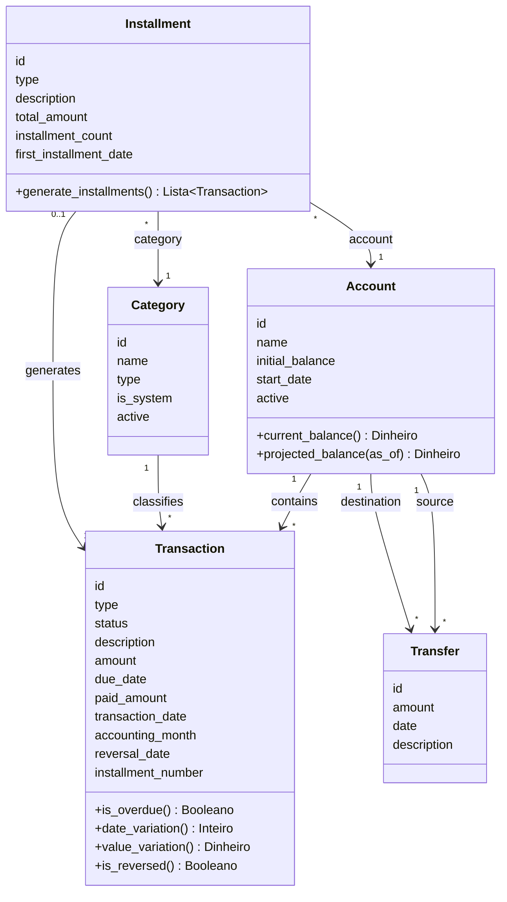

# 05 — Modelo de domínio

- **Status:** Revisado
- **Versão:** 0.2
- **Última atualização:** 16-10-2026

Modelo conceitual do domínio: entidades, atributos, relacionamentos e fronteiras
de consistência.

## Diagrama de classes (conceitual)

Todas as entidades de negócio pertencem a um **Usuário** (o usuário padrão no
MVP). Ele foi omitido do diagrama para não poluí-lo com cinco setas.

## Entidades

### Account

Fonte financeira real do usuário.

| Atributo          | Tipo     | Obrigatório | Descrição                      |
| ----------------- | -------- | ----------- | ------------------------------ |
| `id`              | Id       | Sim         | Identificador                  |
| `name`            | Texto    | Sim         | Nome da conta                  |
| `initial_balance` | Dinheiro | Sim         | Saldo Inicial                  |
| `start_date`      | Data     | Sim         | Data de Início do rastreamento |
| `active`          | Booleano | Sim         | Falso quando inativada         |

Derivados (não armazenados): **Saldo Atual** e **Saldo Projetado** em uma Data de
Consulta (D).

### Category

Classificação de lançamentos. Não há hierarquia: toda categoria está no mesmo
nível.

| Atributo    | Tipo               | Obrigatório | Descrição                                       |
| ----------- | ------------------ | ----------- | ----------------------------------------------- |
| `id`        | Id                 | Sim         | Identificador                                   |
| `name`      | Texto              | Sim         | Nome da categoria                               |
| `type`      | Receita ou Despesa | Sim         | Tipo da categoria                               |
| `is_system` | Booleano           | Sim         | Verdadeiro para as Categorias Padrão do Sistema |
| `active`    | Booleano           | Sim         | Falso quando inativada                          |

### Transaction

Unidade central do sistema: uma receita ou despesa, prevista ou realizada.

| Atributo             | Tipo               | Obrigatório                      | Descrição                                               |
| -------------------- | ------------------ | -------------------------------- | ------------------------------------------------------- |
| `id`                 | Id                 | Sim                              | Identificador                                           |
| `type`               | Receita ou Despesa | Sim                              | Natureza do lançamento                                  |
| `status`             | Estado             | Sim                              | Estado do Lançamento (Previsto, Realizado ou Cancelado) |
| `description`        | Texto              | Sim                              | Descrição                                               |
| `amount`             | Dinheiro           | Sim                              | Valor Previsto                                          |
| `due_date`           | Data               | Sim                              | Data Prevista (vencimento)                              |
| `paid_amount`        | Dinheiro           | Somente se Realizado             | Valor Realizado                                         |
| `transaction_date`   | Data               | Somente se Realizado             | Data Realizada                                          |
| `accounting_month`   | Mês de Competência | Sim                              | Mês de Competência                                      |
| `reversal_date`      | Data               | Somente se Realizado e estornado | Data do Estorno                                         |
| `installment_number` | Inteiro            | Somente se for parcela           | Posição da parcela no Parcelamento                      |

Relacionamentos: pertence a exatamente uma **Account**; pertence obrigatoriamente
a uma **Category**; pode pertencer a um **Installment**.

Derivados (não armazenados): **Vencido**, **Variação de Data**, **Variação de
Valor** (absoluta e percentual) e **Estornado**.

### Installment

Divisão de uma operação financeira em parcelas mensais vinculadas, geradas
automaticamente.

| Atributo                 | Tipo               | Obrigatório | Descrição                        |
| ------------------------ | ------------------ | ----------- | -------------------------------- |
| `id`                     | Id                 | Sim         | Identificador                    |
| `type`                   | Receita ou Despesa | Sim         | Natureza das parcelas            |
| `description`            | Texto              | Sim         | Descrição                        |
| `total_amount`           | Dinheiro           | Sim         | Valor total da operação (V)      |
| `installment_count`      | Inteiro            | Sim         | Quantidade de parcelas (N)       |
| `first_installment_date` | Data               | Sim         | Data informada para a 1ª parcela |

Relacionamentos: **Account** e **Category** informadas na criação, usadas para
gerar as parcelas.

### Transfer

Movimentação de dinheiro entre duas contas do próprio usuário.

| Atributo      | Tipo     | Obrigatório | Descrição            |
| ------------- | -------- | ----------- | -------------------- |
| `id`          | Id       | Sim         | Identificador        |
| `amount`      | Dinheiro | Sim         | Valor transferido    |
| `date`        | Data     | Sim         | Dia da transferência |
| `description` | Texto    | Não         | Observação           |

Relacionamentos: uma **Account** de origem e uma **Account** de destino.

### User

Dono dos dados. No MVP existe apenas o usuário padrão.

| Atributo | Tipo  | Obrigatório | Descrição     |
| -------- | ----- | ----------- | ------------- |
| `id`     | Id    | Sim         | Identificador |
| `name`   | Texto | Sim         | Nome          |

## Tipos de valor

| Tipo               | Descrição                                                 |
| ------------------ | --------------------------------------------------------- |
| Id                 | Identificador inteiro, gerado automaticamente             |
| Texto              | Cadeia de caracteres                                      |
| Inteiro            | Número inteiro                                            |
| Booleano           | Verdadeiro ou falso                                       |
| Dinheiro           | Valor em reais, representado por inteiro em centavos      |
| Data               | Dia civil, sem horário e sem fuso                         |
| Mês de Competência | Mês e ano, representado pelo primeiro dia do mês          |
| Receita ou Despesa | Enumeração com os valores Receita e Despesa               |
| Estado             | Enumeração com os valores Previsto, Realizado e Cancelado |

## Relacionamentos

| De          | Para        | Cardinalidade       | Significado                          |
| ----------- | ----------- | ------------------- | ------------------------------------ |
| Account     | Transaction | 1 para muitos       | Todo lançamento pertence a uma conta |
| Category    | Transaction | 1 para muitos       | Lançamento pertence a uma categoria  |
| Installment | Transaction | 0..1 para 1 ou mais | Parcelamento gera as parcelas        |
| Account     | Transfer    | 1 para muitos (×2)  | Conta de origem e conta de destino   |

## Agregados e fronteiras de consistência

| Agregado    | Raiz        | Observação                                                                |
| ----------- | ----------- | ------------------------------------------------------------------------- |
| Transaction | Transaction | O Estorno é parte do próprio lançamento                                   |
| Installment | Installment | Criado junto com todas as suas parcelas, em uma única operação atômica    |
| Transfer    | Transfer    | Altera duas contas em uma única operação atômica                          |
| Account     | Account     | Não guarda saldo: os saldos são sempre calculados a partir dos movimentos |
| Category    | Category    | Independente                                                              |

Depois de gerada, uma parcela é um Lançamento comum: confirmada, cancelada ou
estornada individualmente, sem alterar o Parcelamento nem as outras parcelas.

## Decisões do modelo

- **Não há "tipo de conta"**
  A conta de investimentos é uma conta comum. Se o tipo for necessário no
  futuro, entra como atributo da Conta.

- **Conta e categoria do Parcelamento são as das parcelas na criação**
  Depois de gerada, cada parcela tem a sua própria conta e categoria.

- **O Estorno é um atributo do Lançamento**
  Em vez de um segundo lançamento ligado ao original, o Estorno é a Data do
  Estorno no próprio lançamento. Assim não existe estorno de estorno.

- **Valores derivados não são atributos**
  Vencido, Estornado, variações e saldos são calculados na consulta, nunca
  armazenados.
