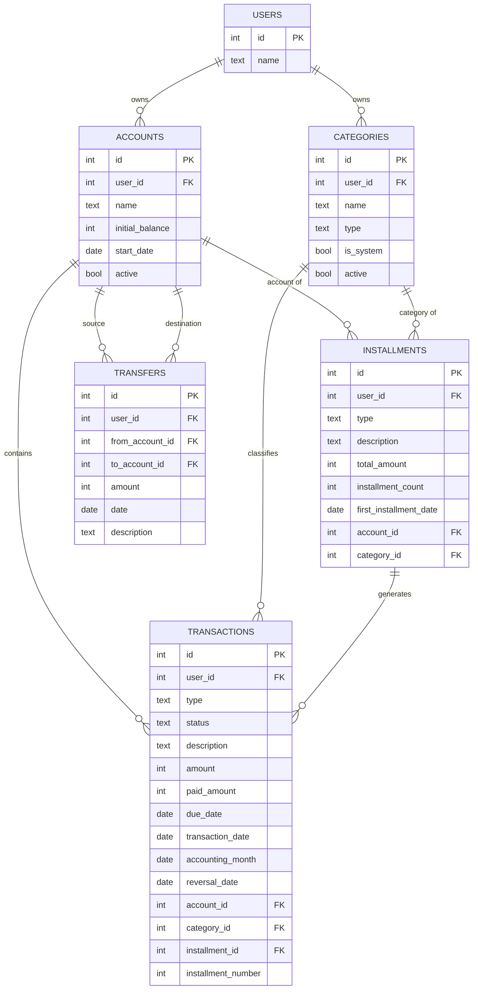

# 06 — Modelo de dados

- **Status:** Rascunho
- **Versão:** 0.1
- **Última atualização:** 16-10-2026
- **SGBD:** a definir

Modelo lógico dos dados, a partir do modelo de domínio. O schema Drizzle é a
definição física: este documento descreve tabelas, colunas e restrições sem
repetir tipos específicos de um banco nem SQL.

## Convenções

- **Dinheiro:** inteiro em centavos.
- **Datas:** tipo data (dia civil), sem horário e sem fuso.
- **Chaves:** inteiro auto incremental.
- **`user_id`:** todas as tabelas, exceto `users`, têm `user_id` obrigatório, com
  padrão 1 (usuário padrão).
- **Colunas técnicas:** `created_at` em todas as tabelas e `updated_at` em
  `transactions`, ambos em UTC. Não aparecem nas tabelas abaixo.
- **Valores derivados** (saldos, Vencido, Estornado, variações) não são colunas.
- **Acesso:** somente por Drizzle.

## DER

## Tabelas

Valores de `type`: `I` (receita) ou `E` (despesa).
Valores de `status`: `P` (Previsto), `C` (Realizado) ou `X` (Cancelado).

### users

| Coluna | Tipo  | Nulo |
| ------ | ----- | ---- |
| `name` | texto | Não  |

### accounts

| Coluna            | Tipo     | Nulo | Observação                          |
| ----------------- | -------- | ---- | ----------------------------------- |
| `name`            | texto    | Não  |                                     |
| `initial_balance` | inteiro  | Não  | Centavos; pode ser zero ou negativo |
| `start_date`      | data     | Não  |                                     |
| `active`          | booleano | Não  | Padrão verdadeiro                   |

### categories

| Coluna      | Tipo     | Nulo | Observação        |
| ----------- | -------- | ---- | ----------------- |
| `name`      | texto    | Não  |                   |
| `type`      | `I`/`E`  | Não  |                   |
| `is_system` | booleano | Não  | Padrão falso      |
| `active`    | booleano | Não  | Padrão verdadeiro |

### installments

| Coluna                   | Tipo    | Nulo | Observação             |
| ------------------------ | ------- | ---- | ---------------------- |
| `type`                   | `I`/`E` | Não  |                        |
| `description`            | texto   | Não  |                        |
| `total_amount`           | inteiro | Não  | Centavos               |
| `installment_count`      | inteiro | Não  |                        |
| `first_installment_date` | data    | Não  |                        |
| `account_id`             | chave   | Não  | Conta das parcelas     |
| `category_id`            | chave   | Não  | Categoria das parcelas |

### transactions

| Coluna               | Tipo        | Nulo | Observação                   |
| -------------------- | ----------- | ---- | ---------------------------- |
| `type`               | `I`/`E`     | Não  |                              |
| `status`             | `P`/`C`/`X` | Não  |                              |
| `description`        | texto       | Não  |                              |
| `amount`             | inteiro     | Não  | Valor Previsto, em centavos  |
| `due_date`           | data        | Não  | Data Prevista                |
| `paid_amount`        | inteiro     | Sim  | Valor Realizado, em centavos |
| `transaction_date`   | data        | Sim  | Data Realizada               |
| `accounting_month`   | data        | Não  | Mês de Competência           |
| `reversal_date`      | data        | Sim  | Data do Estorno              |
| `account_id`         | chave       | Não  |                              |
| `category_id`        | chave       | Não  |                              |
| `installment_id`     | chave       | Sim  | Parcelamento de origem       |
| `installment_number` | inteiro     | Sim  | Posição da parcela           |

### transfers

| Coluna            | Tipo    | Nulo | Observação       |
| ----------------- | ------- | ---- | ---------------- |
| `from_account_id` | chave   | Não  | Conta de origem  |
| `to_account_id`   | chave   | Não  | Conta de destino |
| `amount`          | inteiro | Não  | Centavos         |
| `date`            | data    | Não  |                  |
| `description`     | texto   | Sim  |                  |

## Restrições

O banco garante a estrutura. As regras de comportamento (imutabilidade do
Realizado, Estorno uma só vez, travas do Saldo Inicial) ficam no domínio, com
testes.

**transactions**

- `amount` maior que zero; `paid_amount`, quando existe, também.
- Realizado tem `transaction_date` e `paid_amount`; Previsto e Cancelado não têm.
- `reversal_date` só existe em Realizado e é igual ou posterior a
  `transaction_date`.
- `accounting_month` é o dia 01 de um mês e não é posterior a `due_date`.
- `installment_id` e `installment_number` existem juntos ou nenhum dos dois, e o
  par é único.
- A categoria tem o mesmo tipo do lançamento: `(category_id, type)` referencia
  `categories (id, type)`.

**categories**

- Único `(user_id, type, name)`.
- Único `(id, type)`, alvo da referência acima.
- Categoria do sistema é sempre ativa.

**installments**

- `total_amount` maior que zero e `installment_count` maior ou igual a 1.
- `(category_id, type)` referencia `categories (id, type)`.

**transfers**

- `amount` maior que zero e origem diferente do destino.

**Em todas:** nenhuma exclusão em cascata.

## Índices

Em `transactions`, `(account_id, due_date)`, `(account_id, transaction_date)` e
`(account_id, accounting_month)`, que sustentam as visões de caixa e de
competência. Em `transfers`, `(from_account_id, date)` e `(to_account_id, date)`.

## Decisões de modelagem

- **Previsto e Realizado na mesma linha:** a variação sai da própria linha, sem
  junção.
- **Dois eixos de tempo:** caixa (`due_date`, `transaction_date`) e competência
  (`accounting_month`) são colunas distintas.
- **Estorno em `reversal_date`:** o lançamento não é duplicado.
- **Transferência em tabela própria:** não é receita nem despesa.
- **Parcelamento sem estado:** é derivado das parcelas.
- **Categoria obrigatória:** `category_id` não nulo; a atribuição da Categoria
  Padrão do Sistema é feita pela aplicação.
- **Dinheiro em centavos:** o Drizzle devolve tipos decimais como texto, e o
  inteiro evita uma biblioteca decimal.
