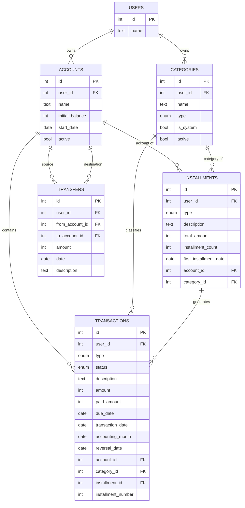

# Modelo de dados

- **Status:** Pronto
- **Versão:** 2.0
- **Última atualização:** 06-11-2026
- **SGBD:** PostgreSQL

Entidades, tabelas, colunas e restrições do banco. O schema Drizzle é a
definição física: este documento descreve a estrutura sem repetir SQL. Os termos
estão no [glossário](glossario.md) e as regras de comportamento, em
[regras](regras.md).

## Convenções

- **Chaves:** inteiro gerado pelo banco (identity). Toda tabela tem `id`.
- **Dinheiro:** inteiro em centavos, até R$ 21.474.836,47 por valor.
- **Datas:** dia civil, sem horário e sem fuso (`date`). No código, trafegam
  como texto `AAAA-MM-DD`, nunca como objeto de data, para não sofrerem
  conversão de fuso.
- **Mês de competência:** `date` sempre no dia 01 do mês.
- **`type` e `status`:** enums nativos do PostgreSQL (`pgEnum` no Drizzle), um
  para o tipo e outro para o estado.
- **`user_id`:** todas as tabelas, exceto `users`, têm `user_id` obrigatório,
  com padrão 1 (usuário padrão).
- **Colunas técnicas:** `created_at` em todas as tabelas e `updated_at` em
  `transactions`, em UTC (`timestamptz`). Não aparecem nas tabelas abaixo.
- **Valores calculados** não são colunas (ver [abaixo](#valores-calculados)).
- **Acesso:** somente por Drizzle.

Valores de `type`: `I` (receita) ou `E` (despesa).
Valores de `status`: `P` (Previsto), `C` (Realizado) ou `X` (Cancelado).

## DER

Todas as tabelas, exceto `users`, também apontam para `users` por `user_id`. As
setas foram omitidas do diagrama para não poluí-lo.

## Tabelas

### users

Dono dos dados. No MVP existe apenas o usuário padrão (`id = 1`).

| Coluna | Tipo  | Nulo | Descrição |
| ------ | ----- | ---- | --------- |
| `name` | texto | Não  | Nome      |

### accounts

Onde o dinheiro está (conta corrente, carteira, investimentos). Não há "tipo de
conta": uma conta de investimentos é uma conta comum. Se o tipo for necessário
no futuro, entra como coluna.

| Coluna            | Tipo     | Nulo | Descrição                                             |
| ----------------- | -------- | ---- | ----------------------------------------------------- |
| `name`            | texto    | Não  | Nome da conta                                         |
| `initial_balance` | inteiro  | Não  | Saldo inicial, em centavos; pode ser zero ou negativo |
| `start_date`      | data     | Não  | Data de início do rastreamento                        |
| `active`          | booleano | Não  | Padrão verdadeiro; falso quando inativada             |

### categories

Classificação dos lançamentos, sem hierarquia: toda categoria está no mesmo
nível.

| Coluna      | Tipo     | Nulo | Descrição                                                 |
| ----------- | -------- | ---- | --------------------------------------------------------- |
| `name`      | texto    | Não  | Nome da categoria                                         |
| `type`      | `I`/`E`  | Não  | Tipo da categoria                                         |
| `is_system` | booleano | Não  | Padrão falso; verdadeiro nas categorias padrão do sistema |
| `active`    | booleano | Não  | Padrão verdadeiro; falso quando inativada                 |

### transactions

O lançamento: a tabela central. Previsto e Realizado ficam na mesma linha, então
a variação sai da própria linha, sem junção. Pertence a uma conta e a uma
categoria e, se for parcela, a um parcelamento.

| Coluna               | Tipo        | Nulo | Descrição                                     |
| -------------------- | ----------- | ---- | --------------------------------------------- |
| `type`               | `I`/`E`     | Não  | Receita ou despesa                            |
| `status`             | `P`/`C`/`X` | Não  | Estado do lançamento                          |
| `description`        | texto       | Não  | Descrição                                     |
| `amount`             | inteiro     | Não  | Valor previsto, em centavos                   |
| `due_date`           | data        | Não  | Data prevista (vencimento)                    |
| `paid_amount`        | inteiro     | Sim  | Valor realizado, em centavos. Só em Realizado |
| `transaction_date`   | data        | Sim  | Data realizada. Só em Realizado               |
| `accounting_month`   | data        | Não  | Mês de competência                            |
| `reversal_date`      | data        | Sim  | Data do estorno. Só em Realizado estornado    |
| `account_id`         | chave       | Não  | Conta do lançamento                           |
| `category_id`        | chave       | Não  | Categoria do lançamento                       |
| `installment_id`     | chave       | Sim  | Parcelamento de origem, se for parcela        |
| `installment_number` | inteiro     | Sim  | Posição da parcela no parcelamento            |

### installments

Divisão de uma operação em parcelas mensais. Guarda os dados usados para gerar as
parcelas; depois de geradas, cada parcela é um lançamento comum, com a sua
própria conta e categoria. Não tem estado: é derivado das parcelas.

| Coluna                   | Tipo    | Nulo | Descrição                            |
| ------------------------ | ------- | ---- | ------------------------------------ |
| `type`                   | `I`/`E` | Não  | Natureza das parcelas                |
| `description`            | texto   | Não  | Descrição                            |
| `total_amount`           | inteiro | Não  | Valor total da operação, em centavos |
| `installment_count`      | inteiro | Não  | Quantidade de parcelas               |
| `first_installment_date` | data    | Não  | Data informada para a 1ª parcela     |
| `account_id`             | chave   | Não  | Conta informada na criação           |
| `category_id`            | chave   | Não  | Categoria informada na criação       |

### transfers

Dinheiro que muda de uma conta para outra, em tabela própria porque não é
receita nem despesa.

| Coluna            | Tipo    | Nulo | Descrição            |
| ----------------- | ------- | ---- | -------------------- |
| `from_account_id` | chave   | Não  | Conta de origem      |
| `to_account_id`   | chave   | Não  | Conta de destino     |
| `amount`          | inteiro | Não  | Valor, em centavos   |
| `date`            | data    | Não  | Dia da transferência |
| `description`     | texto   | Sim  | Observação           |

## Valores calculados

Não são colunas: são calculados na consulta, nunca armazenados. A conta, em
particular, não guarda saldo: os saldos saem sempre dos movimentos.

| Valor                        | Calculado a partir de                                   |
| ---------------------------- | ------------------------------------------------------- |
| Saldo atual, saldo projetado | `accounts`, `transactions` e `transfers`                |
| Saldo acumulado, resultado   | `transactions` e `transfers`, por período               |
| Vencido                      | `status`, `due_date` e hoje                             |
| Variação de data e de valor  | `due_date`, `transaction_date`, `amount`, `paid_amount` |
| Estornado                    | `reversal_date` preenchida                              |

## Restrições

O banco garante a estrutura. As regras de comportamento (imutabilidade do
Realizado, estorno uma só vez, travas do saldo inicial) ficam no domínio, com
testes.

**Propriedade dos dados:** conta, categoria e parcelamento referenciados por um
registro pertencem ao mesmo usuário dele. Cada referência é uma chave composta
com `user_id`, e as tabelas referenciadas têm o único correspondente como alvo.

**accounts**

- Único `(id, user_id)`, alvo das referências.

**categories**

- Único `(user_id, type, name)`.
- Único `(id, user_id, type)`, alvo das referências.
- Categoria do sistema é sempre ativa.

**installments**

- Único `(id, user_id)`, alvo das referências.
- `total_amount` maior que zero e `installment_count` maior ou igual a 1.
- A conta é do mesmo usuário: `(account_id, user_id)` referencia
  `accounts (id, user_id)`.
- A categoria é do mesmo usuário e tem o mesmo tipo:
  `(category_id, user_id, type)` referencia `categories (id, user_id, type)`.

**transactions**

- `amount` maior que zero; `paid_amount`, quando existe, também.
- Realizado tem `transaction_date` e `paid_amount`; Previsto e Cancelado não têm.
- `reversal_date` só existe em Realizado e é igual ou posterior a
  `transaction_date`.
- `accounting_month` é o dia 01 de um mês e não é posterior a `due_date`.
- `installment_id` e `installment_number` existem juntos ou nenhum dos dois, e o
  par é único.
- A conta é do mesmo usuário: `(account_id, user_id)` referencia
  `accounts (id, user_id)`.
- A categoria é do mesmo usuário e tem o mesmo tipo:
  `(category_id, user_id, type)` referencia `categories (id, user_id, type)`.
- O parcelamento, quando existe, é do mesmo usuário:
  `(installment_id, user_id)` referencia `installments (id, user_id)`.

**transfers**

- `amount` maior que zero.
- Origem diferente do destino.
- Origem e destino são do mesmo usuário da transferência:
  `(from_account_id, user_id)` e `(to_account_id, user_id)` referenciam
  `accounts (id, user_id)`.

**Em todas:** nenhuma exclusão em cascata.

## Índices

Para sustentar as visões diária e mensal em `transactions`:

- `(account_id, due_date)`
- `(account_id, transaction_date)`
- `(account_id, accounting_month)`

Em `transfers`:

- `(from_account_id, date)`
- `(to_account_id, date)`

## Decisões de modelagem

- **Previsto e Realizado na mesma linha:** a variação sai da própria linha, sem
  junção.
- **Duas datas para o dinheiro e o orçamento:** a data do dinheiro (`due_date`,
  `transaction_date`) e o mês de competência (`accounting_month`) são colunas
  distintas.
- **Estorno em `reversal_date`:** o lançamento não é duplicado. Assim não existe
  estorno de estorno.
- **Transferência em tabela própria:** não é receita nem despesa.
- **Parcelamento e transferência são gravados em uma única transação de banco:**
  uma falha no meio não deixa dados parciais.
- **Conta e categoria do parcelamento valem só na criação:** depois de geradas,
  cada parcela tem as suas.
- **Categoria obrigatória:** `category_id` não nulo; a atribuição da categoria
  padrão do sistema é feita pela aplicação.
- **Enums nativos para tipo e estado:** são valores fixos, então o banco os
  valida e o Drizzle os tipa.
- **Dinheiro em centavos:** o Drizzle devolve tipos decimais como texto, e o
  inteiro evita uma biblioteca decimal.
- **Saldos e demais valores calculados não são guardados:** evita divergência
  entre o saldo salvo e os movimentos.
- **Referências compostas com `user_id`:** o banco garante que um registro nunca
  aponte para conta, categoria ou parcelamento de outro usuário, em vez de
  depender só da camada de acesso a dados. Na categoria, a mesma referência
  garante também o tipo.
